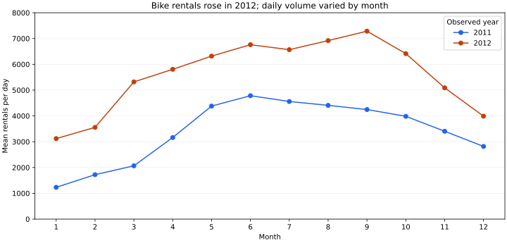
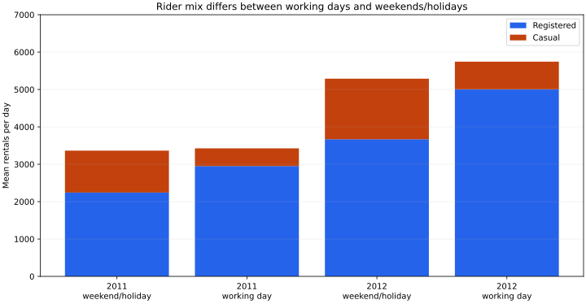

# Bike demand: when should an operator investigate different service needs?

**Question:** How did average daily rentals and rider mix differ between working days and weekends/holidays in 2011–2012, and what does that suggest investigating before planning capacity?

This is a retrospective portfolio analysis of public daily aggregates from Capital Bikeshare. It is not commissioned work, a forecast, an optimization model or evidence of commercial impact.

## Results from the executed pipeline

| Year | Observed days | Rentals | Mean rentals/day |
| --- | ---: | ---: | ---: |
| 2011 | 365 | 1,243,103 | 3,405.76 |
| 2012 | 366 | 2,049,576 | 5,599.93 |

Mean daily rentals were **64.43% higher in 2012**. Using daily means avoids attributing an extra leap-year day to daily demand growth. The data do not identify the causes of the increase.



The rider mix matters as much as the total. In 2012, working days averaged **5,744.58 rentals**, compared with **5,288.19** on weekends/holidays. Casual riders accounted for **12.88%** of rentals on working days and **30.62%** on weekends/holidays. These shares are ratios of total casual rentals to total rentals within each group, not averages of daily percentages.



**Decision implication:** investigate separate working-day and weekend/holiday service patterns, and use the more recent year as a starting point for further validation. Before changing staffing or fleet allocation, obtain current station-level and hourly demand, capacity, availability and cost data. Daily system-wide counts cannot identify station shortages or determine a fleet size.

Weather groups also differ in the descriptive summaries, but adverse-weather group 3 contains only **15 days in 2011 and 6 in 2012**. There are no group-4 days in this daily file. Weather, season, year and system changes are confounded; no causal weather effect is estimated.

## Reproduce

Tested on Linux with Python 3.13.13. From the repository root:

```bash
python3 -m venv .venv
source .venv/bin/activate
python -m pip install -r requirements.txt
python projects/bike_demand/run.py
python -m unittest discover -s tests -v
```

Installation uses the package registry. Analysis then runs entirely offline from the included 56 KB CSV. It uses Python's standard-library SQLite, executes the [SQL files](sql/), saves [CSV summaries and metrics](outputs/), and draws two charts with matplotlib. Dependencies and the tested resolution are pinned in the root requirements files. Those files cover the new demonstrations, not the historical notebooks.

## Data and quality checks

- Unit of analysis: one day, 1 January 2011 through 31 December 2012, **731 rows**.
- [Source and reuse terms](data/README.md), [download/checksum metadata](data/source.json), [unchanged source CSV](data/day.csv).
- SHA-256 verification before loading; exact column schema and daily coverage.
- SQL primary/unique keys, non-null fields, ranges and `casual + registered = cnt`.
- Date/year/month/weekday consistency and working-day/holiday consistency.
- Independent Python CSV sums checked against SQL annual totals and monthly reconciliation.
- Negative tests reject a modified source and an inconsistent total.

The data contain aggregate rental counts, not personal records. Rentals are trips/counts, not unique people. No missing values were observed in the supplied daily file; the checks fail instead of silently imputing or dropping rows.

## Limitations and authorship

Only two historical years and one system are represented. Changes in service area, capacity, adoption or reporting may affect observed rentals. Observed rentals may understate unmet demand. This descriptive study has no randomized treatment, predictive holdout, uncertainty intervals, revenue data or staffing costs. It should not be generalized to today's operations without new evidence.

The source is credited under its own CC BY 4.0 terms; no repository-wide license or third-party relicensing is introduced. Analysis code, tests, charts and narrative were prepared with AI assistance and executed against the cited data. The findings are measured outputs of this pipeline, not evidence of unaided professional performance.
